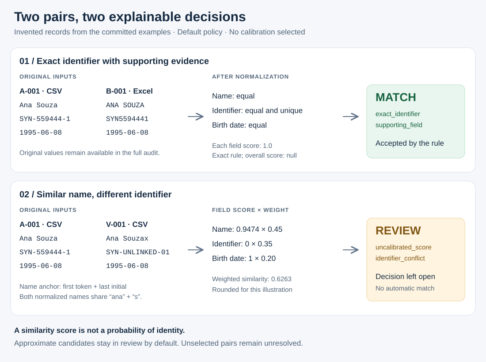

# Entity Resolution Engine

[](https://github.com/JhoCruz/entity-resolution-engine/actions/workflows/ci.yml)
[](https://www.python.org/)
[](LICENSE)

Compare CSV and Excel files to find records that may refer to the same person. The engine
keeps the evidence behind each decision and sends uncertain pairs to review. It runs locally
through a command-line interface.

## Why this project

This project connects my experience checking data in spreadsheets to my interest in data
analysis and data science. I wanted to explore a practical question: what evidence is
enough to say that records in two different files describe the same person?

The workflow starts with simple identifier rules, then uses name and date keys to select
additional pairs for comparison. Each result includes field scores and reasons so a person
can check what happened. The local workflow also gives me a way to study the whole process,
from the original files to a match or a case that needs review.

One tradeoff matters throughout: limiting comparisons makes the workflow manageable, but can
miss a true pair. Records that were never compared remain unresolved.

## See the result

The two cases below come from the invented records in `examples/data/`. One pair has matching
identifiers and supporting fields. The other has a similar name and the same date, but
conflicting identifiers, so it needs review.



Follow the [worked example](docs/EXAMPLE_WALKTHROUGH.md) for the inputs, actual component scores,
commands, and a record-by-record explanation. The [first demo](docs/FIRST_DEMO.md) covers the
complete example runs.

## Run it

Install Python 3.12 or newer and [`uv`](https://docs.astral.sh/uv/), then run:

```bash
git clone https://github.com/JhoCruz/entity-resolution-engine.git
cd entity-resolution-engine
uv sync --locked
uv run entity-resolution-engine doctor
uv run entity-resolution-engine reconcile --config examples/basic-job.toml --output reports/exact
uv run entity-resolution-engine reconcile --config examples/name-variants-job.toml --output reports/variants
```

Each output directory must be new. The first run accepts four pairs; the second sends two
pairs to review. Both examples are synthetic.

To check the files and mappings before matching, run:

```bash
uv run entity-resolution-engine inspect --config examples/basic-job.toml
```

## How decisions are made

1. Load the two sources and check required columns and unique row identifiers.
2. Create comparison keys while keeping the original values and normalization steps.
3. Accept an exact identifier pair only when another field agrees, no usable field conflicts,
   and neither row has competing candidates.
4. Select additional pairs through bounded name keys and an exact-date fallback.
5. Score their fields and send them to review by default.

Missing or invalid fields do not add positive evidence. A similarity score is not a probability
that two records belong to the same person. The optional [synthetic calibration example](docs/CALIBRATION.md)
can apply match and rejection thresholds, with extra safeguards; it has not been validated on
real-world records.

## Read the reports

| File | Contents |
| --- | --- |
| `summary.json` | Row counts, selected pairs, decisions, and unresolved counts. |
| `matches.jsonl` | Accepted pairs and the evidence supporting each decision. |
| `reviews.jsonl` | Pairs that need a person to check them. |
| `non_matches.jsonl` | Explicit rejections when the optional calibrated policy is used. |
| `conflicts.jsonl` | Pairs with conflicting evidence, also included in reviews. |

The default reports use fresh random row references and omit source values and original row
numbers. To trace a result back to the original **synthetic** inputs, request the full local audit:

```bash
uv run entity-resolution-engine reconcile --config examples/basic-job.toml --output reports/exact-audit --full-audit
```

This adds `full/normalized_left.jsonl`, `full/normalized_right.jsonl`, and `full/audit.jsonl`.
The full audit contains original values and should stay private. Reduced references are
pseudonyms, not a guarantee of anonymity. See the [report format](docs/REPORTS.md) for details.

## Evaluation and tests

Evaluation uses fixed-seed synthetic records with separate tuning and held-out labels. To
reproduce the published baseline artifact:

```bash
uv run python scripts/evaluate_benchmark.py --output reports/baseline.json
```

The [evaluation notes](docs/EVALUATION.md) explain the dataset and metrics. These results do not
establish accuracy on real people. Test coverage measures which code ran during tests; it does
not measure the percentage of correctly identified records.

For the test suite, type checks, formatting, and development setup, see
[CONTRIBUTING.md](CONTRIBUTING.md).

## Project reference

| Topic | Guide |
| --- | --- |
| Source files, mappings, and weights | [Configuration](docs/CONFIGURATION.md) |
| Comparison keys and supported formats | [Normalization](docs/NORMALIZATION.md) |
| Exact identifier decisions | [Exact baseline](docs/EXACT_BASELINE.md) |
| Candidate selection and its limits | [Name blocking](docs/NAME_BLOCKING.md), [date blocking](docs/DATE_BLOCKING.md) |
| Runtime and candidate counts | [Performance](docs/PERFORMANCE.md) |
| Module responsibilities | [Architecture](docs/ARCHITECTURE.md) |
| Completed release criteria and deferred work | [Roadmap](docs/ROADMAP.md) |

All committed examples and benchmarks use invented data. Keep generated reports under
`reports/`, which is ignored by Git. The released workflow is a local CLI; the deferred work
is listed in the roadmap.

Released under the [MIT License](LICENSE).
