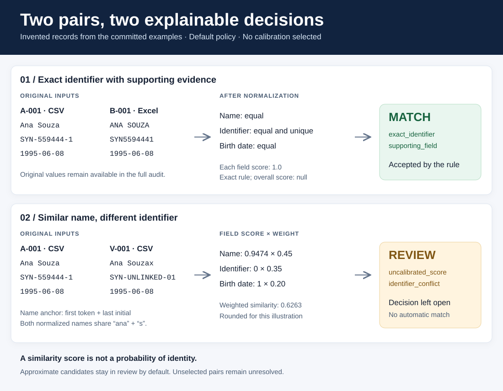

# Entity Resolution Engine

[](https://github.com/JhoCruz/entity-resolution-engine/actions/workflows/ci.yml)
[](https://www.python.org/)
[](LICENSE)

O Entity Resolution Engine cruza dois arquivos, em CSV ou Excel (`.xlsx`), para
encontrar registros que podem pertencer à mesma pessoa. Ele roda localmente pelo
terminal e gera relatórios com as evidências de cada decisão.

[Read in English](README.md) · [Como rodar](#como-rodar) · [Dois casos da demonstração](#dois-casos-da-demonstração)

[](docs/images/matching-example.svg)

## Que problema o projeto resolve

O projeto nasceu da minha experiência conferindo dados em planilhas e do meu
interesse em análise e ciência de dados. Quando duas bases foram preenchidas
separadamente, o mesmo nome pode aparecer com grafias diferentes e o mesmo
identificador pode vir com ou sem pontuação. A pergunta é quanta evidência basta
para vincular duas linhas à mesma pessoa.

Comparar todas as linhas de uma base com todas as da outra custa caro à medida
que os arquivos crescem. Com mil linhas de cada lado, há um milhão de pares
possíveis. O motor usa chaves de comparação para selecionar candidatos. Pares
que ficam fora dessa seleção permanecem sem avaliação, inclusive possíveis
pares corretos.

## Como o motor decide

1. **Lê e valida as fontes.** O arquivo de configuração informa quais colunas
   correspondem entre as bases e qual coluna identifica cada linha.
2. **Normaliza os campos para comparação.** Cria chaves comparáveis e preserva os
   valores de origem para a auditoria.
3. **Verifica os identificadores exatos.** Para aceitar um par automaticamente,
   os identificadores que ligam o par precisam ser únicos em cada fonte. Um
   campo de outro tipo, como a data de nascimento, também precisa coincidir. Valores inválidos,
   campos que divergem e vínculos concorrentes levam à revisão.
4. **Busca outros candidatos por nome e data.** O motor usa chaves derivadas dos
   nomes e faz uma busca adicional por datas iguais. Calcula a semelhança com
   os pesos da configuração. Campos ausentes ou inválidos ficam fora do cálculo.
   No modo padrão, esses candidatos vão para revisão.

A pontuação resume a semelhança dos campos comparados. O relatório também
mostra quais campos coincidiram, quais divergiram e qual regra levou à decisão.
Há uma política opcional de limiares calibrada com dados fictícios. Os pares
encontrados apenas pela data continuam em revisão. [Guia de calibração](docs/CALIBRATION.md)

## Dois casos da demonstração

| Par de registros fictícios | Evidência | Decisão |
| --- | --- | --- |
| `A-001` e `B-001` | `Ana Souza` e `ANA SOUZA` ficam iguais após a normalização. Os identificadores `SYN-559444-1` e `SYN5594441` também ficam iguais, e a data de nascimento coincide. | Vínculo automático (`match`) |
| `A-001` e `V-001` | `Ana Souza` e `Ana Souzax` têm nomes parecidos e a mesma data de nascimento. Os identificadores divergem. | Revisão (`review`) |

O segundo par tem pontuação ponderada de aproximadamente **0,63**. O relatório
registra a divergência com o motivo `identifier_conflict`. O passo a passo traz
as notas e os pesos de cada campo. [Exemplo completo](docs/EXAMPLE_WALKTHROUGH.md)

## Como rodar

Instale Python 3.12 ou superior e o [uv](https://docs.astral.sh/uv/). Em seguida,
rode os comandos no terminal.

```bash
git clone https://github.com/JhoCruz/entity-resolution-engine.git
cd entity-resolution-engine
uv sync --locked
uv run entity-resolution-engine doctor
uv run entity-resolution-engine inspect --config examples/basic-job.toml
uv run entity-resolution-engine reconcile --config examples/basic-job.toml --output reports/exact
uv run entity-resolution-engine reconcile --config examples/name-variants-job.toml --output reports/variants
```

Os dados fictícios já estão no repositório. O comando `inspect` confere as fontes
e o mapeamento antes da comparação. Para repetir `reconcile`, escolha um caminho
de saída novo, como `reports/exact-2`.

| Configuração | Arquivos | Pares selecionados | Vínculos automáticos | Pares em revisão |
| --- | --- | ---: | ---: | ---: |
| `basic-job.toml` | CSV e Excel | 4 de 16 | 4 | 0 |
| `name-variants-job.toml` | Dois CSVs | 2 de 8 | 0 | 2 |

## Como ler os relatórios

Comece pelo `summary.json` dentro de cada pasta de saída. Os arquivos `.jsonl`
têm uma decisão em JSON por linha.

| Arquivo | O que mostra |
| --- | --- |
| `summary.json` | Contagens de linhas, pares selecionados e decisões. |
| `matches.jsonl` | Vínculos aceitos e as evidências que os sustentam. |
| `reviews.jsonl` | Pares que precisam de conferência humana. |
| `non_matches.jsonl` | Rejeições explícitas quando a política opcional de calibração é usada. |
| `conflicts.jsonl` | Casos com evidências conflitantes. Esses pares também aparecem em `reviews.jsonl`. |

A saída padrão usa referências aleatórias por execução e omite os valores de
origem e os números das linhas. Para acompanhar os valores originais e
normalizados da demonstração, gere uma auditoria completa com os dados fictícios.

```bash
uv run entity-resolution-engine reconcile --config examples/name-variants-job.toml --output reports/variants-audit --full-audit
```

A subpasta `full/` contém os registros originais e normalizados de cada fonte e
as evidências dos pares. Guarde auditorias com dados pessoais em uma pasta
privada. As referências da saída padrão são pseudônimos. [Formato dos relatórios](docs/REPORTS.md)

## Avaliação e testes

A avaliação usa duas amostras fictícias com sementes diferentes. Na amostra
final, o motor encontrou os 63 pares corretos conhecidos entre os candidatos.
Aceitou 23 automaticamente (**recall de 36,5%**) e encaminhou os outros 40 para
revisão. Todos os vínculos automáticos estavam corretos nessa amostra
(**precisão de 100%**). [Resultados da avaliação](docs/evaluation/baseline.json)

Para reproduzir o resultado, rode o comando abaixo.

```bash
uv run python scripts/evaluate_benchmark.py --output reports/baseline.json
```

Os testes e as verificações de desenvolvimento estão no guia de contribuição.
As notas da avaliação explicam como as métricas foram calculadas. [Guia de contribuição](CONTRIBUTING.md) · [Notas da avaliação](docs/EVALUATION.md)

## Documentação técnica

- Arquivos de entrada, mapeamentos e pesos. [Configuração](docs/CONFIGURATION.md)
- Formatos aceitos e regras de comparação. [Normalização](docs/NORMALIZATION.md) · [Identificadores exatos](docs/EXACT_BASELINE.md)
- Seleção de pares e desempenho. [Chaves de nome](docs/NAME_BLOCKING.md) · [Chaves de data](docs/DATE_BLOCKING.md) · [Desempenho](docs/PERFORMANCE.md)
- Organização do código e próximos passos. [Arquitetura](docs/ARCHITECTURE.md) · [Próximos passos](docs/ROADMAP.md)

Distribuído sob a [licença MIT](LICENSE).
